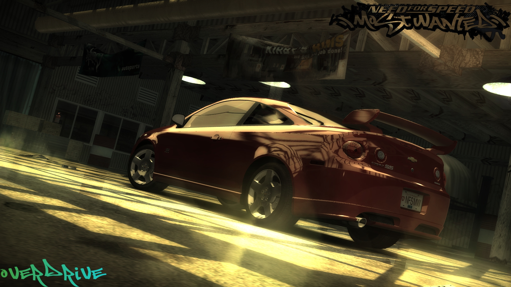

# NFSMW Overdrive

An ASI plugin for *Need for Speed: Most Wanted* (2005, PC).

**Five-speed cars get their sixth gear from the first transmission package
instead of the last.** Fit a Race gearbox to a Cobalt SS and it pulls sixth,
rather than making you wait for the Ultimate package.

Cars with a stock gearbox are untouched, and upgrading anything else — engine,
nitrous, tyres — does not trigger it.

**The Ultimate transmission package brings the straight-cut gear whine.** MW
only gives the M3 GTR's straight-cut gearbox sound to a car whose engine audio
has it switched on in the VLT, so a car either has it or never will. With this
plugin, beat Webster, fit the Ultimate transmission, and the whine kicks in.

## Install

Drop `NFSMWOverdrive.asi` and `NFSMWOverdrive.ini` into the game's
`scripts` folder. Uninstall by deleting the two files.

You need an ASI loader, which you already have if you run any other MW mods.
Plays nicely alongside Unlimiter, Bartender, ExtraOptions and the Widescreen
Fix.

## Settings

`NFSMWOverdrive.ini`, read once at launch.

| Key | Default | |
| --- | --- | --- |
| `[Gears] Enabled` | `1` | the feature |
| `[Gears] IncludeStock` | `0` | also give the 6th to cars with no gearbox upgrade |
| `[Tranny] Enabled` | `1` | the straight-cut whine with the Ultimate transmission |

## Build

Visual Studio, `Release|Win32`. Output is `Release/NFSMWOverdrive.asi`. The
`Debug|Win32` build is the same plugin with a log.

| | |
| --- | --- |
| `src/dllmain.cpp` | entry point |
| `src/NFSMW/transmission.hpp` | the game classes, with EA's names and layouts |
| `src/NFSMW/transmission.cpp` | the ini, the 6th gear and the straight-cut whine |
